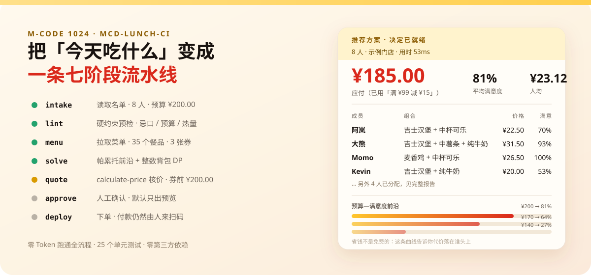

# 午餐流水线 · mcd-lunch-ci

> 把「今天吃什么」从 20 分钟的群聊战争，变成一条 **7 阶段 CI 流水线**。

<div align="center">
  
</div>

<p align="center">
  
  
  
  
  
</p>

---

## 30 秒上手（不需要 MCP Token）

```bash
git clone https://github.com/<you>/mcd-lunch-ci.git
cd mcd-lunch-ci
python -m mcd_lunch_ci demo
```

`demo` 用**从真实 MCP 同步下来的菜单快照**跑完整条流水线，**不发一个网络请求、不需要任何密钥**，直接把结果打到终端：

```
  午餐流水线  mcd-lunch-ci
  8 人 · 团队预算 ¥200.00 · 麦当劳深圳同方信息港餐厅 · 数据源 离线快照

  ✓ [1/7] 读取名单  8 人，预算 ¥200.00（0ms）
  ✓ [2/7] 硬约束预检 通过
  ! [3/7] 拉取菜单  102 个餐品、0 张券，45 个缺营养数据，设了热量上限的 1 位已排除这类餐品（0ms）
  ✓ [4/7] 求解方案  帕累托前沿 + 预算 DP，最优解 3 档（1282ms）
  ! [5/7] 核对金额  ¥199.40 · 离线快照价，未经 calculate-price 核价（0ms）
  - [6/7] 人工确认  未带 --confirm，停在预览（默认行为）
  - [7/7] 下单      预览载荷已就绪，未产生真实订单（0ms）

  推荐方案  推荐方案 · 应付 ¥199.40 · 未核价
  ┌───────┬────────────────────────────────────┬───────┬─────────┬────────┐
  │ 成员  │ 组合                               │ 热量  │ 价格    │ 满意度 │
  ├───────┼────────────────────────────────────┼───────┼─────────┼────────┤
  │ 阿岚  │ 蘸酱炸鸡 + 圆筒冰淇淋 + 可乐       │ 未知  │ ¥26.40  │ 89%    │
  │ 大熊  │ 牛肉堡单品精选 + 圆筒冰淇淋 + 可乐 │ 未知  │ ¥29.50  │ 90%    │
  │ Momo  │ 麦香鸡 + 派                        │ 601   │ ¥25.50  │ 100%   │
  │ Kevin │ 麦香鸡 + 圆筒冰淇淋                │ 462   │ ¥22.00  │ 70%    │
  │ 小满  │ 麦香鸡 + 圆筒冰淇淋                │ 462   │ ¥22.00  │ 83%    │
  │ 阿哲  │ 麦辣鸡腿汉堡                       │ 485   │ ¥22.50  │ 100%   │
  │ 老周  │ 牛肉堡单品精选 + 圆筒冰淇淋        │ 未知  │ ¥20.00  │ 38%    │
  │ Yuki  │ 麦香鸡 + 圆筒冰淇淋 + 可乐         │ 609   │ ¥31.50  │ 100%   │
  ├───────┼────────────────────────────────────┼───────┼─────────┼────────┤
  │ 合计  │ 8 人 · 18 件                       │ ≥3192 │ ¥199.40 │ 84%    │
  └───────┴────────────────────────────────────┴───────┴─────────┴────────┘

  谁妥协了
    · 老周：拿到 牛肉堡单品精选 + 圆筒冰淇淋，满意度 38%；他更想吃 巨无霸 + 派 + 可乐（¥43.50），差 ¥23.50
    · Kevin：拿到 麦香鸡 + 圆筒冰淇淋，满意度 70%；他更想吃 麦香鸡 + 【美汁源】"黄金橙橙"（¥30.00），差 ¥8.00
    · 小满：拿到 麦香鸡 + 圆筒冰淇淋，满意度 83%；他更想吃 麦香鸡 + 派（¥25.50），差 ¥3.50

  预算—满意度前沿
    · 推荐方案   应付   ¥199.40  人均   ¥24.92   平均满意度 84%
    · 省着点方案 应付   ¥168.80  人均   ¥21.10   平均满意度 64%
    · 极限方案   应付   ¥138.60  人均   ¥17.32   平均满意度 39%
```

注意「热量」那一列：营养数据缺失的餐品显示 **未知**，合计写 **≥3192**。缺数据不等于 0 卡，报告不会把「不知道」伪装成一个数字。

同时会生成三份产物：`out/lunch-report.md`（可直接贴进 GitHub 评论）、`out/lunch-card.html`（一张能转发的卡片）、`out/plan.json`（给自动化用）。

---

## 它解决的到底是什么问题

团队点午餐的真实流程是这样的：

1. 有人在大群问「吃什么」，20 分钟没人回；
2. 有人说「我不吃辣」，有人说「我减脂」，有人说「我乳糖不耐」，有人说「我就 25 块」；
3. 有人扔出一个 Excel，没人看；
4. 最后有个倒霉蛋凭记忆点了一单，80% 有人不满意；
5. 没人知道这单到底花了多少、有没有用上券。

**这本质上是一个带硬约束的多目标寻优问题，而人类在用群聊做分布式求解。** 结果当然是收敛慢、解很差、还容易有人吃到不能吃的东西。

`mcd-lunch-ci` 把它改成一条流水线：每个人的约束写进配置（或在 Issue 里回一行命令），求解器负责把冲突谈成一份**可解释、可复核、可下单**的方案。

## 为什么不是「又一个点餐助手」

| 常见做法 | 问题 | 本项目的做法 |
| --- | --- | --- |
| 让大模型"推荐几份套餐" | 会编价格、会漏掉忌口、结果不可复现 | 硬约束在代码里过滤，**大模型没有权限放行过敏原** |
| 单纯比价 / 省钱 | 榜单上的红海，且不解决多人冲突 | 目标是**社会福利最大化**，预算只是约束之一 |
| 算个大概总价 | 金额单位混用会差 100 倍 | 所有金额强制走 `Money`（整数分），单位必须显式声明 |
| 直接下单 | 误下单事故不可逆 | 默认**停在预览**，下单需要 `--confirm` 显式开启 |
| 输出一份方案 | 有人不满意但没人知道为什么 | 输出「**谁妥协了、差多少**」，把谈判摆到台面上 |

一句话：**别人在做"推荐"，本项目在做"决议"。**

---

## 七个阶段

| 阶段 | 做什么 | 失败时 |
| --- | --- | --- |
| `intake` | 载入名单与团队预算 | 团队为空 → 提示先收集成员 |
| `lint` | 预检重名、个人预算之和是否对得上团队预算、热量上限是否低于任何主食 | 给出提示但继续（`warn`） |
| `menu` | 拉菜单 + 营养数据；午餐时段自动排除早餐专属餐品 | 缺营养数据 → 标记为 `unavailable`，不编造 |
| `solve` | 帕累托前沿 + 整数背包 DP 求最优分配 | 无可行解 → **指名道姓**说明谁卡住了、差多少钱 |
| `quote` | 调 `calculate-price` 核价，与本地求和交叉校验 | 解析失败 → 回退本地求和并**标注"未核价"** |
| `approve` | 默认停在预览；`--confirm` 才放行真实下单 | — |
| `deploy` | `create-order` 下单并返回支付链接 | 打印原始回包，不静默失败 |

阶段名故意复用 CI 词汇，因为它就是一条 CI：每个阶段要么过，要么带着**可执行的原因**失败。

---

## 方案是怎么算出来的

### 1. 效用函数（可加，才有最优解可谈）

对每个人 $i$ 和候选组合 $c$：

```
u_i(c) = 1.2                      # 有主食
       + 0.35·[有小食] + 0.45·[有饮料]
       + Σ_items 0.15·(popularity − 0.5)
       + Σ_tags (like_i[tag] − dislike_i[tag])
       + 0.9 · max(0, 1 − |kcal − target_i| / target_i)
       − 0.5·[主食 ∈ 最近吃过]
```

### 2. 硬约束先砍，绝不"稍微超一点"

忌口标签、个人预算、热量上限是**过滤条件**，不是惩罚项。`avoid_tags` 命中即淘汰——过敏这件事没有"罚 0.2 分"的余地。

### 3. 帕累托前沿 + 整数背包 DP

每个人先把自己所有可行组合按 `(价格, 效用)` 做一次**帕累托过滤**：如果存在"更便宜且不更难吃"的方案，贵的那个直接丢掉。剩下的是前沿，再取 top-40。

然后对团队预算做整数分桶 DP（默认 0.5 元一桶）：

```
dp[k][b] = max Σ u_i(c_i)   s.t.  Σ price_i ≤ b
```

得到的是该尺度下的**精确最优解**，不是贪心近似。`tests/test_solver.py::test_dp_matches_bruteforce` 用穷举做了对数验证。

### 4. 有界去重：最优解经常是「八个人八份吉士汉堡」

DP 只看总效用，不看"这顿饭像不像人吃的"。所以在最优解之上再做一次**有界替换**：把重复主食的人换成别的主食，代价是总效用最多下降 3%，且不允许把人的"汉堡+饮料"降级成"光一个汉堡"。

这是可解释的工程折中，不是暗改——报告里会写明替换了几份、福利掉了多少。

---

## 把谈判摆到台面上：「谁妥协了」

大多数点餐工具只给你一个结果。本项目额外回答一个问题：**这份方案里，谁受了委屈，委屈了多少？**

- 每个人有一个 `ceiling`（预算无限时他会选什么）和 `floor`（最差能接受什么）；
- 满意度 = `1 − (ceiling − 实际) / (ceiling − floor)`；
- 报告按"后悔值"排序，输出前几名。

于是「Kevin 只拿到 53% 满意度」这句话是可以拿去跟 Kevin 谈的，而不是"AI 说要这么点"。

## 预算—满意度前沿

同一批人，预算从 ¥200 压到 ¥140，平均满意度从 81% 掉到 27%。**这条曲线才是该给老板看的东西**：省钱不是免费的，代价具体掉在谁头上，一目了然。

---

## 接入真实麦当劳 MCP（已实测跑通）

1. 到 [open.mcd.cn/mcp](https://open.mcd.cn/mcp) 用手机号登录 → 控制台 → 激活 → 复制 MCP Token。
2. 写进项目根目录的 `.env`（已在 `.gitignore` 里，不会进仓库）：

```bash
# .env
MCD_MCP_TOKEN=你的Token
```

3. 自检 → 同步菜单 → 实时核价：

```bash
python -m mcd_lunch_ci doctor                 # 连通性 + 门店 + 菜单 + 核价，四步全绿才算通
python -m mcd_lunch_ci sync --refresh         # 从真实 MCP 拉全量菜单，落成本地快照
python -m mcd_lunch_ci run --live             # 实时链路（含官方核价）
```

`doctor` 实测输出（真实运行结果）：

```
[ OK ] 已连接 mcd-mcp 1.0.0
[ OK ] 可用工具 35 个
       ✓ query-meals            ✓ calculate-price
       ✓ query-meal-detail      ✓ query-store-coupons
       ✓ list-nutrition-foods   ✓ create-order
[ OK ] 门店 麦当劳深圳同方信息港餐厅（storeCode=1420762，403m）
[ OK ] 餐品 102 个（burger=54, dessert=6, drink=19, kids=3, side=20）
[ OK ] 营养覆盖 57/102
[ OK ] 最便宜：圆筒冰淇淋 ¥5.00（dessert）
[ OK ] 核价 2×圆筒冰淇淋 = ¥10.00（原始字段 price=1000 分）
[ OK ] 取餐方式：eat-in
```

`run --live` 会把官方核价与本地求和做对账——实测两者**分毫不差**：

```
  ✓ [5/7] 核对金额  ¥199.40 · 已通过官方 calculate-price 核价（单位：分）
```

真实下单必须显式加 `--confirm`：

```bash
python -m mcd_lunch_ci run --live              # 只出预览载荷，不产生订单（默认）
python -m mcd_lunch_ci run --live --confirm    # 真的下单，返回支付链接
```

下单预览载荷（真实结构，`orderType=1` 到店自取）：

```json
{"storeCode":"1420762","orderType":1,"beType":1,
 "items":[{"productCode":"515837","quantity":6},{"productCode":"9900008751","quantity":3}],
 "takeWayCode":"eat-in","needTableware":false,
 "remark":"mcd-lunch-ci 团队午餐 8 人"}
```

> **边界说清楚**：本项目只负责"建单"，付款永远由人扫码完成。Agent 不碰钱。
> 演示脚本也不会调用 `delivery-create-address`、`auto-bind-coupons` 这类会往你账号里写数据的接口。

## 在 GitHub Issue 里用：`/lunch`

同事不用装任何东西，在 Issue 里回一行就完成报名：

```
/lunch join name=阿岚 budget=30 avoid=猪肉 likes=咖啡
/lunch join name=Kevin budget=30 maxkcal=600 avoid=炸 target=550
/lunch approve
/lunch veto 牛
```

然后汇总成团队配置，再跑流水线：

```bash
python -m mcd_lunch_ci tally --comments comments.json --budget 200 --out team.json
python -m mcd_lunch_ci run --team team.json --offline
```

仓库里附了可直接用的 GitHub Action（`.github/workflows/lunch.yml` + `action.yml`）：在 PR/Issue 评论里发 `/lunch`，机器人回一张方案卡片。Token 走仓库 Secret，不落盘。

---

## 目录结构

```
mcd-lunch-ci/
├── mcd_lunch_ci/
│   ├── money.py       # 整数分金额 + 强制单位声明（防 100 倍错误）
│   ├── models.py      # 餐品 / 组合 / 成员 / 方案
│   ├── solver.py      # 帕累托前沿 + 整数背包 DP + 有界去重
│   ├── provider.py    # 离线快照 / 在线 MCP 两套数据源，同一接口
│   ├── mcp_client.py  # 零依赖 MCP 客户端（Streamable HTTP / SSE）
│   ├── live.py        # 真实 MCP 适配：门店→菜单→详情→单价→核价→下单
│   ├── nutrition_table.py  # list-nutrition-foods 的类 CSV 文本解析
│   ├── pipeline.py    # 七阶段编排 + 产物落盘
│   ├── report.py      # 终端 / Markdown / HTML 三种报告
│   ├── votes.py       # 解析 Issue 评论里的 /lunch 指令
│   └── cli.py         # demo / sync / run / doctor / tally
├── data/              # 快照：live_menu_snapshot.json（真实同步）+ menu_snapshot.json（样例）
├── examples/team.json # 8 人示例团队
├── tests/             # 40 个单元测试
├── docs/              # hero 图、MCP_FIELD_MAP.md（实测字段表）、提交说明
├── action.yml
└── .github/workflows/lunch.yml
```

## 测试

```bash
python -m unittest discover -s tests -t . -v
# Ran 40 tests ... OK
```

覆盖：金额单位陷阱、DP 与穷举对数、硬约束零泄漏（过敏原/热量/预算）、无解诊断、前沿单调性、去重不降级、七个阶段产物、`/lunch` 指令解析，以及真实 MCP 协议适配（混合文本抠 JSON、类 CSV 营养表、品类推断、牛奶≠牛肉、缺营养不得绕过热量上限）。

---

## 安全与边界（很重要，请读完）

- **不代付**：只创建订单，支付由人完成；`--confirm` 是唯一不可逆开关，默认关闭。
- **Token 不落盘**：只从环境变量读取，仓库里没有任何真实凭证；`out/live-trace.json` 只存业务回包。
- **不编造数据**：拿不到营养数据就标记 `unavailable`，核价失败就标「未核价」，绝不用模型记忆里的价格顶替。
- **忌口标签是推断的**：在线菜单不带成分标签时，`classify_tag()` 按餐品名保守推断（宁可多标）。**过敏原判断请以门店/官方成分表为准，本项目不能替代医疗建议。**
- **价格为快照**：`data/live_menu_snapshot.json` 是从真实 MCP 同步的菜单（含同步时间与门店号），但价格随时段/门店变化，正式下单前请用 `--live` 实时核价。
- **营养缺失不放行**：给某人设了热量上限时，营养数据缺失的餐品**不能进入他的候选**——「没有数据」不等于「0 卡」。报告里这类热量显示为「未知」。

## 已知的坑（顺手写给同行）

| 坑 | 说明 |
| --- | --- |
| 金额单位不统一 | 餐品价是元、主题活动场次价是分。本项目用 `Money` + `parse_amount(v, unit)` 强制声明，单位未知直接抛错 |
| 早餐餐品不存在于午餐菜单 | 如果不按时段过滤，求解器会给午餐塞一份麦满分。`meal_period` 负责这件事 |
| 纯最优解不像人吃的 | 八份吉士汉堡在数学上最优。需要额外的多样性项，见"有界去重" |
| 429 限流 | 600 次/分钟。批量跑请串行 + 退避，别在循环里刷 |
| 返回体是「说明文字 + JSON」 | `content[].text` 前面挂了一段给模型看的提示语，`json.loads` 必炸。要扫文本抠 JSON |
| 菜单接口不给名称和价格 | `query-meals` 只返回 `{code, tags}`；名称靠 `query-meal-detail`，价格只能靠 `calculate-price` 反推 |
| 批量核价会把满减摊到每个商品 | 一次核 100 个餐品，返回的 `subtotal` 是摊过折扣的价，拿它当单价会让本地少算 ¥40（实测 ¥199.90 vs 官方 ¥222.40）。单价必须逐项核 |
| 营养表是 CSV 文本且按**餐品名**索引 | 按 code join 会全军覆没；缺失值是 `null`，`int()` 会抛异常；表头尾冒号会变成一行假数据 |
| 品类名不是餐品分类 | `人气热卖` 里既有巨无霸也有丝巾；`麦辣鸡腿汉堡` 因为含"鸡腿"会被判成小食。要用「结构词优先」的规则 |
| 「纯牛奶」含"牛" | 一度被标成牛肉过敏原。过敏原误标比漏标更丢人，要用否定前瞻排除 `牛奶/牛油果` |

完整实测字段表见 [`docs/MCP_FIELD_MAP.md`](docs/MCP_FIELD_MAP.md)。

---

## 声明

本项目是**麦当劳程序员创意开发大赛（M-CODE 1024）参赛作品**，由参赛者独立开发，**非麦当劳官方产品**。项目输出仅供参考，不构成医疗、营养或其他专业建议；餐品信息、价格及供应状态以麦当劳官方渠道的实时结果为准。使用麦当劳 MCP 服务须遵守麦当劳中国的《使用条款》与《麦当劳 MCP 服务规则》。

开发过程记录见 [`workbuddy.md`](workbuddy.md)，MCP 接入细节见 [`MCP_INTEGRATION.md`](MCP_INTEGRATION.md)，参赛声明见 [`CONTEST_DECLARATION.md`](CONTEST_DECLARATION.md)。

MIT License · 用 WorkBuddy 开发
